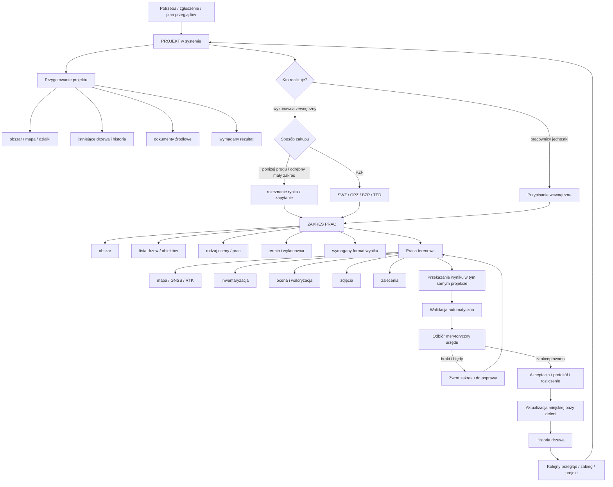

# Zarządzanie zielenią miejską przez polskie samorządy — model operacyjny, zamówienia, GIS, finansowanie i szansa produktowa

## Streszczenie wykonawcze

Przegląd przepisów, standardów miejskich, publicznych systemów GIS oraz zamówień z Warszawy, Gdańska, Krakowa, Łodzi, Wrocławia, Poznania i Szczecina prowadzi do dość jednoznacznego wniosku: **polskie samorządy nie zarządzają zielenią według jednego modelu**. W większych miastach funkcjonują wyspecjalizowane zarządy zieleni lub jednostki komunalne, w mniejszych zadania są skupione w wydziałach gospodarki komunalnej, ochrony środowiska albo drogownictwa. Bardzo częsty jest model **hybrydowy**: urząd lub miejska jednostka zachowuje kontrolę nad zasobem, priorytetami, odbiorami i częścią przeglądów, natomiast terenowe wykonanie prac, duże inwentaryzacje oraz specjalistyczne ekspertyzy zleca na zewnątrz. citeturn23view0turn26search11turn27search2

To jest dobra wiadomość dla rozważanej aplikacji. Nie należy jej pozycjonować ani jako wyłącznie „programu dla arborysty”, ani jako wyłącznie „systemu urzędowego”. Najbardziej obiecująca pozycja to:

> **wspólna platforma projektowa dla zarządcy zieleni i wykonawcy, w której urząd może przygotować projekt i zakres prac, przekazać całość lub część wykonawcy, odebrać wyniki i zachować historię drzew, a arborysta może równie dobrze utworzyć i wykonać cały projekt samodzielnie bez udziału urzędu.**

Takie podejście dobrze odpowiada faktycznym procesom. Warszawski standard wprost przewiduje zarówno dendrologów i „ogrodników” zatrudnionych w miejskich jednostkach, jak i możliwość zlecania ich zadań wykonawcom zewnętrznym, jeśli jednostka nie ma odpowiednich zasobów. Jednocześnie Warszawa wymaga zachowania ciągłości dokumentacji przy przekazywaniu terenów pomiędzy zarządcami. citeturn23view0turn24view0

W zakresie IT nie ma jednego ogólnopolskiego „systemu drzew”. Warszawa używa **Bazy Zieleni, ArcZieleń i MoDrzew**, Kraków wykorzystuje centralny system zarządzania zielenią **GreenSpaces** i wymaga określonych danych w plikach Shapefile, a Poznań rozwija **Portal Zielony / Bazę danych zieleni** prowadzoną przez GEOPOZ. Jednocześnie państwowa infrastruktura GUGiK zapewnia WMS, WMTS, WFS i inne usługi przestrzenne, a ASG‑EUPOS zapewnia bezpłatne usługi korekcyjne GNSS/RTK. citeturn23view0turn26search4turn26search2turn12search0turn12search11

To oznacza, że z punktu widzenia produktu **integracyjność jest ważniejsza niż narzucenie własnego formatu**. Aplikacja powinna posiadać własny, bogaty model danych projektu i drzewa, ale eksportować/importować dane do świata GIS: przynajmniej SHP, GeoPackage, CSV/XLSX, DXF oraz PDF, a w dalszej kolejności umożliwiać integracje API/WFS i dedykowane adaptery do systemów miejskich. W badanych źródłach znalazłem wyraźnie udokumentowane wymagania dotyczące Shapefile, elektronicznych kart drzew, dokumentacji fotograficznej i szczegółowych atrybutów; **nie znalazłem natomiast jednego państwowego schematu danych drzewa obowiązującego wszystkie gminy**. To wskazuje na potrzebę konfigurowalnych schematów i mapowania pól. citeturn26search4turn24view2

Rynek zamówień również nie ogranicza się do prostego koszenia. Sam Gdańsk w 2025 r. zlecił trzy części inwentaryzacji dendrologicznej za łącznie około **793,8 tys. zł**, Warszawa zleca osobno inwentaryzacje, specjalistyczne oceny i utrzymanie zieleni, Łódź rozpisała utrzymanie zieleni na lata 2025–2027 na **17 rejonów**, a Warszawa-Bielany miała kontrakt na utrzymanie zieleni przyulicznej o wartości po aneksie ponad **1,058 mln zł brutto**. citeturn16search0turn18search3turn20search0turn27search2turn19search0

Dodatkowym impulsem dla cyfryzacji jest prawo klimatyczne. Dla miast mających co najmniej 20 tys. mieszkańców wprowadzono obowiązek sporządzania miejskich planów adaptacji. MPA ma zawierać m.in. **koncepcję zazieleniania miasta, zbiory danych przestrzennych, działania, mierniki i mechanizm monitorowania**, a monitoring jest cyklicznie raportowany. To zwiększa potrzebę posiadania aktualnych, przestrzennych i historycznych danych o zieleni. citeturn14view0

Najważniejszy wniosek biznesowy jest więc taki:

> **Produktem o największym potencjale nie jest „ArboMap 2”, lecz system operacyjny projektu związanego z drzewostanem: projekt → zakres prac → obiekty/drzewa → wykonawca → teren → ocena → zalecenia → dokumentacja → odbiór → historia.**

ArboMap pozostaje bardzo dobrym benchmarkiem dla ergonomii pracy arborysty w terenie: obsługuje mapy, WMS Geoportalu, GNSS, zdjęcia, formularze, DXF/PDF/XLSX/CSV/SHP. fileciteturn0file3 Przykład rzeczywistego programu prac, który otrzymałeś od arborysty, pokazuje natomiast, że finalna dokumentacja obejmuje nie tylko inwentaryzację, ale opis metod, tabelę, mapę, dokumentację zdjęciową i oznaczenie zakresu cięć. fileciteturn0file0 To właśnie przestrzeń pomiędzy „zebraniem danych” a „zarządzaniem zleceniem i gotową dokumentacją” wydaje się najbardziej interesującą luką.

## Ramy prawne i organizacja gospodarki zielenią

### Obowiązki gminy

Podstawą jest ustawa o samorządzie gminnym. Do zadań własnych gminy należy m.in. zaspokajanie zbiorowych potrzeb wspólnoty w zakresie **zieleni gminnej i zadrzewień**. Ten obowiązek jest wprost przywoływany także przez zamawiających w dokumentach zamówień dotyczących utrzymania zieleni. citeturn19search0

Jeszcze bardziej bezpośredni jest art. 78 ustawy o ochronie przyrody. Po zmianach obowiązujących w obecnym stanie prawnym mówi on, że **organy gminy są obowiązane zakładać i utrzymywać w należytym stanie tereny zieleni i zadrzewienia**. Przepisy wymagają również, aby przy zakładaniu terenów zieleni w pierwszej kolejności wykorzystywać zasoby przyrodnicze terenu i zachowywać rodzimą roślinność, a przy utrzymaniu priorytetowo traktować funkcje przyrodnicze i ekstensywną pielęgnację. citeturn15view2turn13search3

Ustawa o ochronie przyrody reguluje również usuwanie drzew. Co do zasady zezwolenie wydaje wójt, burmistrz lub prezydent miasta; dla nieruchomości lub jej części wpisanej do rejestru zabytków właściwy jest wojewódzki konserwator zabytków. W przypadku drzew w pasie drogowym drogi publicznej ustawa przewiduje dodatkowo uzgodnienie z regionalnym dyrektorem ochrony środowiska, z ustawowymi wyjątkami. citeturn12search15turn12search13

Dla aplikacji ma to praktyczną konsekwencję: **projekt powinien wiedzieć, na jakim typie terenu pracujemy**. Pas drogowy, park, zabytek, pomnik przyrody, teren inwestycyjny czy zwykła działka miejska mogą wymagać odmiennych formularzy, procedur, dokumentów i akceptacji.

### Miejskie plany adaptacji stają się ważnym motorem cyfryzacji

Nowe przepisy dotyczące MPA mają szczególne znaczenie biznesowe. Dla miast o liczbie mieszkańców co najmniej 20 tys. sporządza się miejski plan adaptacji. Ustawa wymaga, aby plan zawierał m.in.:

- analizę zagrożeń klimatycznych,
- koncepcję zazieleniania miasta,
- koncepcję gospodarowania wodami opadowymi,
- **zbiór danych przestrzennych**,
- mierniki i wskaźniki,
- harmonogram działań,
- zasady monitorowania. citeturn14view0

Burmistrz lub prezydent ma monitorować wdrażanie działań, sporządzać cykliczne sprawozdania, a sam MPA podlega aktualizacji nie rzadziej niż raz na sześć lat. citeturn14view0

Z perspektywy produktu jest to bardzo mocny argument za projektowaniem systemu nie jako „jednorazowego formularza inwentaryzacyjnego”, lecz jako **bazy historycznej i systemu monitorowania zasobu**.

### Modele organizacyjne spotykane w samorządach

Badane miasta pokazują trzy główne modele.

**Model wyspecjalizowanej jednostki miejskiej** występuje m.in. w Warszawie, Krakowie, Wrocławiu, Łodzi i Gdańsku. Funkcjonują tam Zarządy Zieleni Miejskiej, Zarząd Zieleni, Gdański Zarząd Dróg i Zieleni itp. Jednostka miejska odpowiada za zarządzanie zasobem, ale duża część prac jest kupowana na rynku. citeturn19search7turn26search11turn27search3turn27search2turn16search0

**Model wydziałowy** występuje w części samorządów, gdzie zadania zieleni znajdują się w wydziale ochrony środowiska, gospodarki komunalnej, zieleni albo drogownictwa. W Lublinie Wydział Zieleni i Gospodarki Komunalnej odpowiada za rozległy zasób miejskiej zieleni, podczas gdy specjalistyczne i wykonawcze zadania mogą być dalej powierzane podmiotom zewnętrznym. citeturn8search5

**Model wielojednostkowy** dobrze widać w Szczecinie. Biuro Ogrodnika Miasta przygotowuje wytyczne i opiniuje rozwiązania, Zakład Usług Komunalnych wykonuje lub zleca część prac, a konkretne projekty wymagają uzgodnień także z innymi zarządcami. W projekcie „Drzewa dla Szczecina” zlecono np. geodezyjny domiar drzew, podczas gdy późniejsze nasadzenia realizował ZUK. citeturn26search0turn26search5

### Co urząd wykonuje sam, a co oddaje na zewnątrz

Najbardziej czytelnego podziału dostarcza Warszawa. Miejski standard definiuje dendrologa jako pracownika miejskiej jednostki, ale wprost mówi, że jeśli jednostka takiego pracownika nie zatrudnia, zadanie może zostać zlecone zewnętrznemu wykonawcy. Analogicznie definiowany jest „ogrodnik”: może być pracownikiem merytorycznym jednostki albo osobą działającą na jej zlecenie. citeturn23view0

W praktyce **wewnątrz urzędu/jednostki** często pozostają:

zarządzanie zasobem i budżetem, ustalanie priorytetów, podstawowe przeglądy, odbiór zgłoszeń, planowanie prac, wydawanie lub prowadzenie decyzji administracyjnych, kontrola wykonawców, odbiory, prowadzenie miejskiej bazy oraz część podstawowych ocen. Warszawski standard przewiduje nawet plany przeglądów na ok. 3–5 lat. citeturn23view0turn24view0

**Na zewnątrz** bardzo często wychodzą:

duże inwentaryzacje, pielęgnacja i cięcia, wycinki, frezowanie pni, nasadzenia i późniejsza pielęgnacja, prace wysokościowe, specjalistyczne ekspertyzy dendrologiczne, badania fitopatologiczne i entomologiczne, pomiary geodezyjne oraz prace projektowe. W Warszawie zewnętrzna ekspertyza jest formalnie osobnym poziomem oceny i może wymagać m.in. tomografii dźwiękowej, wiertarki oporowej lub innych metod diagnostycznych. citeturn24view2turn20search0turn27search2

To silnie wspiera Wasz pomysł **`Projekt → ZakresPrac → Wykonawca`**, zamiast prostego modelu „urząd wysyła plik arborysty”.

## Zamówienia publiczne i typowy przepływ pracy

### Jak samorządy kupują usługi zieleni

Od 1 stycznia 2026 r. próg stosowania ustawy Prawo zamówień publicznych został podwyższony z 130 tys. do **170 tys. zł netto**. Poniżej tej wartości samorządy nadal muszą wydawać środki publiczne w sposób racjonalny, przejrzysty i zapewniający konkurencyjność, ale stosują swoje regulaminy zakupowe, rozeznania rynku i zapytania ofertowe zamiast pełnej procedury PZP. citeturn0search0turn0search6

W latach 2026–2027 dla zamawiających subcentralnych, do których należą zasadniczo JST, unijny próg dla klasycznych zamówień na dostawy i usługi wynosi **216 tys. EUR, czyli 930 960 zł netto**. Powyżej niego pojawiają się procedury o reżimie unijnym i publikacja w TED; poniżej progu unijnego, ale powyżej 170 tys. zł, typowym mechanizmem jest krajowa procedura PZP. citeturn2view2

Dla produktu B2G ma to ogromne znaczenie. Autentycznie wydzielony, ograniczony zakresowo **pilotaż systemu** może być prostszy zakupowo, jeżeli jego wartość pozostaje poniżej ustawowego progu. Nie wolno natomiast sztucznie dzielić jednego przewidywalnego zamówienia tylko po to, aby ominąć PZP.

### Jak wyglądają zamówienia w praktyce

**Gdańsk — duża inwentaryzacja dendrologiczna.** Gdański Zarząd Dróg i Zieleni w 2025 r. rozpisał „Inwentaryzację dendrologiczną na terenach Gminy Miasta Gdańska” na trzy części: Cmentarz Srebrzysko, południowo-wschodnie pasy drogowe i północno-zachodnie pasy drogowe. Postępowanie przeprowadzono w trybie podstawowym z art. 275 pkt 2 PZP. Zawarte umowy miały wartości 203 872,50 zł, 294 954 zł i 294 954 zł, czyli łącznie ok. **793 781 zł**. citeturn16search0turn18search3

**Warszawa — specjalistyczna inwentaryzacja jako mniejszy zakup.** Zarząd Zieleni m.st. Warszawy w październiku 2025 r. prowadził zamówienie poniżej 170 tys. zł na wykonanie inwentaryzacji dendrologicznej wraz z zaleceniami gospodarki drzew i krzewów na częściach Wału Średnicowego i Wału Miedzeszyńskiego. Do zapytania dołączono m.in. mapę obszaru, warunki techniczne, wzór umowy oraz warszawski standard przeglądów i analiz dendrologicznych. citeturn20search0

**Warszawa-Bielany — utrzymanie bieżące.** Umowa na utrzymanie i konserwację zieleni przyulicznej dróg gminnych miała pierwotnie wartość 962 394,65 zł brutto. W toku realizacji została zwiększona o 96 041,28 zł, do **1 058 435,93 zł brutto**, ponieważ konieczne było zapewnienie ciągłości usług do końca okresu umowy. citeturn19search0

**Łódź — outsourcing obszarowy na kilka lat.** Zarząd Zieleni Miejskiej rozpisał utrzymanie zieleni w pasach dróg i na nieruchomościach niezabudowanych na lata **2025–2027 na 17 części/rejonów**. Zakres obejmuje m.in. wycinanie, pielęgnację i sadzenie drzew, usuwanie wiatrołomów oraz frezowanie pni. Jeden wykonawca mógł złożyć ofertę maksymalnie na cztery części. Postępowanie było prowadzone centralnie przez Wydział Zamówień Publicznych Urzędu Miasta i opublikowane w systemie TED/e‑Zamówienia. citeturn27search2

**Wrocław — od utrzymania po kilkuletnią pielęgnację.** ZZM zleca m.in. kompleksową pielęgnację i wycinkę wysokiej zieleni oraz nasadzenia. W jednym z zamówień 2026 dotyczących akcji „Wrośnij we Wrocław” wartość wynosiła 275 302,80 zł, a zakres obejmował dostarczenie drzew, posadzenie i **trzyletnią pielęgnację gwarancyjną**. citeturn27search6turn27search10

### Wzorce zamówień ważne dla projektowanego systemu

Z badanych postępowań wyłania się kilka regularności.

Po pierwsze, duże zamówienia są **dzielone przestrzennie na rejony lub części**. Gdańsk miał trzy części inwentaryzacji, Łódź siedemnaście rejonów utrzymania. To bezpośrednio wspiera encję `ZakresPrac`, która może zawierać obszar, zestaw drzew i wykonawcę. citeturn16search0turn27search2

Po drugie, zakres kontraktu często jest określony **obiektowo i ilościowo**. W publicznych OPZ można spotkać osobne pozycje dla wycinek według obwodu, pielęgnacji metodą alpinistyczną, frezowania, zabezpieczeń czy nasadzeń; zamawiający może zastrzegać minimalny procent faktycznie zlecanych ilości. citeturn19search2

Po trzecie, zamówienia na nowe drzewa bardzo często łączą **dostawę + sadzenie + późniejszą pielęgnację**, nieraz wieloletnią. Oznacza to, że system powinien obsługiwać nie tylko jednorazowe „wykonano”, ale również okres gwarancyjny, harmonogram kolejnych kontroli, podlewania i odbiorów. citeturn27search10turn20search2

Po czwarte, dokumentacja dendrologiczna może bezpośrednio sterować wykonaniem. W jednym z publicznych zamówień pielęgnacji wskazano konkretne setki drzew i podzielono pracę na etapy według numerów inwentaryzacyjnych; szczegółowe sposoby cięcia wynikały z załączonej dokumentacji dendrologicznej. citeturn19search4

### Porównanie wybranych miast i zamówień

| Miasto / przykład | Model | Zakres | Wartość / skala | Dane i rezultaty | GIS / system | Źródło / kontakt |
|---|---|---|---:|---|---|---|
| **Warszawa — model ogólnomiejski** | hybrydowy: pracownicy + eksperci zewnętrzni | przeglądy, oceny, ekspertyzy, planowanie | plan przeglądów ok. 3–5 lat | karty, zdjęcia, klasy ryzyka, historia | Baza Zieleni, ArcZieleń, MoDrzew, ArcGIS | Zarząd Zieleni / OŚ citeturn23view0turn24view0 |
| **Warszawa — Wały, 2025** | outsourcing | inwentaryzacja + gospodarka drzew/krzewów | zamówienie <170 tys. zł | mapa, wymagania techniczne, miejski standard | wymagania zgodne ze standardem miasta | ZZW, nr 235/WZP/2025 citeturn20search0 |
| **Warszawa-Bielany, 2025** | outsourcing utrzymania | zieleń przyuliczna | 1 058 435,93 zł brutto po aneksie | wykonanie bieżących usług | format GIS niewskazany w ogłoszeniu | bielany.zamowienia@um.warszawa.pl citeturn19search0 |
| **Gdańsk, 2025** | outsourcing inwentaryzacji | cmentarz + dwa rejony pasów drogowych | ok. 793 781 zł, 3 części | inwentaryzacja dendrologiczna | dokładny format GIS niewskazany w samym ogłoszeniu BZP | gzdiz-przetargi@gdansk.gda.pl citeturn16search0 |
| **Kraków** | silna jednostka własna + wykonawcy | inwentaryzacja, kontrole, inwestycje | ~250 tys. drzew pod opieką; 170 417 zinwentaryzowanych w III 2025 | metryka i historia każdego drzewa | GreenSpaces, ArboTag, SHP | ZZM Kraków citeturn26search11turn26search4 |
| **Poznań** | kilka miejskich jednostek + outsourcing specjalistyczny | bieżące kontrole i okresowy monitoring ekspercki | wartość: nieustalona | baza zieleni i obsługa mieszkańców | Portal Zielony / GEOPOZ | GEOPOZ citeturn26search2turn7search4 |
| **Łódź, 2025–2027** | duży outsourcing rejonowy | wycinka, pielęgnacja, sadzenie, wiatrołomy, frezowanie | 17 części; wartość łączna niewskazana w przywołanym fragmencie | rozliczanie prac w rejonach | format GIS niewskazany w ogłoszeniu | ZZM Łódź / zamowienia@uml.lodz.pl citeturn27search2 |
| **Wrocław, 2026** | ZZM + wykonawcy | pielęgnacja, wycinka, nasadzenia | np. 275 302,80 zł dla jednego zamówienia z 3-letnią pielęgnacją | sadzenie + historia opieki gwarancyjnej | format nieustalony w ogłoszeniu | sekretariat@zzm.wroc.pl citeturn27search6turn27search10 |
| **Szczecin** | Biuro Ogrodnika + ZUK + wykonawcy | koncepcje, pomiary, nasadzenia | projekt „Drzewa dla Szczecina”: 291 drzew | m.in. domiary geodezyjne, koncepcje i realizacja | szczegółowy format nieustalony | Biuro Ogrodnika Miasta / ZUK citeturn26search0 |
| **Lublin** | wydział miejski + zlecenia zewnętrzne | zarządzanie terenami zieleni, projekty, utrzymanie | blisko 800 ha terenów wskazywanych przez miasto | zakres zależny od zadania | brak jednolitego formatu potwierdzonego w zbadanych materiałach | Wydział Zieleni i Gospodarki Komunalnej citeturn8search5 |

**Uwaga:** „nieustalona/niewskazana” oznacza, że konkretnej wartości albo formatu nie udało się potwierdzić w analizowanym oficjalnym ogłoszeniu; nie oznacza, że takie informacje nie istnieją w pełnym OPZ/SWZ.

### Typowy workflow

Poniższy diagram jest syntezą opisanych modeli Warszawy, Gdańska, Krakowa, Łodzi i Szczecina. citeturn24view0turn16search0turn26search11turn27search2turn26search0



To jest bardzo bliskie modelowi domenowemu, który już ustaliliśmy:

**`Projekt → ZakresPrac → Obiekty → Dane terenowe → Wynik → Odbiór`**.

## GIS, dane przestrzenne i wymiana informacji

### Warszawa: przykład dojrzałej miejskiej architektury danych

Warszawski standard jest szczególnie cenny, ponieważ opisuje nie tylko sposób oceny drzewa, ale również system informacyjny. **ArcZieleń** działa w środowisku ArcGIS i umożliwia opracowywanie oraz gromadzenie danych inwentaryzacyjnych. **MoDrzew** występuje w wersji webowej i mobilnej, pomaga jednostkom i dzielnicom zarządzać drzewami oraz zbierać informacje o ich stanie. Obie aplikacje zapisują informacje do ogólnomiejskiej **Bazy Zieleni**. citeturn23view0

Co bardzo istotne dla Waszej strategii: jednostka może korzystać również z własnego narzędzia, ale jego wprowadzenie trzeba uzgodnić z Biurem Ochrony Środowiska i Biurem Geodezji i Katastru. Warszawa zaleca jednolity sposób gromadzenia danych, a w przypadku zmiany zarządcy dokumentacja powinna zostać przekazana następcy. citeturn24view0

To pokazuje, że dla sprzedaży B2G samo „mamy fajną aplikację” nie wystarczy. Potrzebny będzie:

**model danych + eksport/import + dokumentacja integracyjna + kontrola jakości danych + uprawnienia + historia zmian.**

### Kraków: przykład bardzo konkretnych wymagań dla wykonawców

Kraków jest jeszcze ciekawszy z punktu widzenia interoperacyjności.

ZZM podaje, że pod jego opieką znajduje się prawie **250 tys. drzew**, z których w marcu 2025 r. zinwentaryzowano 170 417. Wszystkie dane trafiają do jednego systemu informatycznego, a drzewa są oznaczane indywidualnymi znacznikami **ArboTag**. Każde zinwentaryzowane drzewo posiada metrykę, do której dopisywane są przeglądy i zabiegi. citeturn26search11

ZZM publikuje też instrukcje dotyczące danych przekazywanych przez wykonawców. W przypadku powykonawczych inwentaryzacji nowo posadzonych drzew i krzewów używany jest **Shapefile**. Dla drzewa należy np. wypełnić atrybut `data_ini` oznaczający datę posadzenia. Po wgraniu SHP do GreenSpaces wykonawca uzupełnia dane, których nie można zaimportować w ten sposób, m.in. zdjęcie, fazę rozwoju fizjologicznego, miejsce rozwoju oraz dodatkowe informacje. W notatce wymagane są również m.in. nazwa firmy, nazwa zadania, okres gwarancji i okres pielęgnacji. citeturn26search4

To jest niemal gotowy przykład use-case'u Waszego produktu:

```text
URZĄD
  ↓
projekt + schemat wymaganych danych
  ↓
WYKONAWCA
  ↓
teren + zdjęcia + atrybuty
  ↓
walidacja wymaganych pól
  ↓
eksport zgodny ze schematem miasta
  ↓
miejska baza
```

### Poznań

GEOPOZ prowadzi **Portal Zielony / Bazę danych zieleni**, opisywaną jako platforma wspierająca zarządzanie zielenią miejską i jednocześnie umożliwiająca mieszkańcom interakcję z informacjami o zieleni. citeturn26search2

To pokazuje jeszcze jeden możliwy segment produktu: poza panelem pracownika i wykonawcy można kiedyś dołączyć **publiczny portal mieszkańca**, jednak nie powinien być to pierwszy etap MVP.

### Geoportal i GUGiK

GUGiK udostępnia publiczne usługi **WMS i WMTS** dla wielu kategorii danych przestrzennych, a także **WFS** do pobierania danych wektorowych. WFS przekazuje dane m.in. w GML. Geoportal prowadzi też katalog setek usług przestrzennych; w chwili badania katalog zawierał 318 usług, w tym 238 WMS, 20 WMTS i 51 WFS. citeturn12search0turn12search1turn12search3

GUGiK w dokumentacji podaje nawet osobne instrukcje podłączania usług WMTS do QGIS. citeturn12search1

Dla aplikacji oznacza to, że nie ma potrzeby „produkowania własnego Geoportalu”. Powinna natomiast umieć **konsumować istniejące usługi państwowe i samorządowe**.

### ASG-EUPOS i GNSS

ASG‑EUPOS zapewnia usługi wspomagania pomiarów GNSS. Oficjalna dokumentacja podaje adres NTRIP Caster oraz osobne porty dla RTN, RTK i DGNSS. Od października 2022 r. usługi ASG‑EUPOS są udostępniane zarejestrowanym użytkownikom nieodpłatnie. citeturn12search11

To pasuje dokładnie do obecnego workflow arborysty, który korzysta z geodezyjnego GNSS/RTK.

### Jakiego zestawu formatów potrzebuje produkt

Na podstawie oficjalnych źródeł oraz obecnego workflow arborystycznego rekomendowałbym taki rdzeń:

| Format / mechanizm | Priorytet | Uzasadnienie |
|---|---:|---|
| **SHP** | bardzo wysoki | realnie wymagany np. przez ZZM Kraków citeturn26search4 |
| **GeoPackage** | bardzo wysoki | nowocześniejszy kontener GIS i bardzo wygodny dla QGIS; w przeanalizowanych materiałach nie znalazłem jednak dowodu, że jest dziś powszechnie obligatoryjny |
| **GeoJSON** | wysoki | naturalny format dla aplikacji webowych/API |
| **CSV/XLSX** | bardzo wysoki | szeroko używany w dokumentacji arborystycznej; ArboMap już go obsługuje fileciteturn0file3 |
| **DXF** | wysoki | realny workflow arborysta/CAD; ArboMap używa DXF jako kluczowego formatu fileciteturn0file3 |
| **PDF** | bardzo wysoki | dokumentacja formalna, raporty, mapy i ekspertyzy |
| **WMS/WMTS** | bardzo wysoki | podkłady i dane GUGiK/miast citeturn12search1 |
| **WFS/GML** | wysoki | integracja wektorowa z infrastrukturą informacji przestrzennej citeturn12search0 |
| **DWG** | średni/wysoki | często pojawia się jako materiał źródłowy, choć technicznie warto rozważyć konwersję zamiast własnej pełnej obsługi CAD |
| **API REST** | docelowo krytyczny B2G | potrzebny do bezpośrednich integracji z miejskimi systemami |

### Jakie atrybuty powinien umieć przechowywać model drzewa

Warszawski standard zewnętrznej ekspertyzy wymaga m.in.:

lokalizacji, warunków siedliskowych, gatunku, obwodu pnia na 130 cm, wysokości, średnicy korony, diagnozy stanu zdrowotnego, patogenów i cech diagnostycznych, statyki/odporności, kolizji z otoczeniem, klasy ryzyka, zaleceń oraz dokumentacji fotograficznej. citeturn24view2

Rzeczywista tabela inwentaryzacyjna przekazana przez Twojego arborystę zawiera bardzo podobny zakres: gatunek, obwód, średnicę korony, wysokość, stan zdrowotny, stabilność, uwagi, zalecenia i współrzędne. fileciteturn0file2

To oznacza, że Wasz wewnętrzny model powinien być **bogatszy niż jakikolwiek pojedynczy eksport miejski**, a przy eksporcie system powinien mapować:

```text
NASZ MODEL DANYCH
      ↓
profil Warszawa
profil Kraków
profil Gmina X
profil klienta prywatnego
profil QGIS
profil Excel/PDF
```

To może być jedna z najcenniejszych warstw technologicznych całego produktu.

## Finansowanie, dotacje i potencjalna droga do pierwszych wdrożeń

### Budżety własne samorządów

Najbardziej oczywistym źródłem finansowania są zwykłe budżety jednostek odpowiedzialnych za zieleń. Skala przywołanych zamówień — od zakupów poniżej 170 tys. zł do wieloczęściowych kontraktów wartych setki tysięcy lub ponad milion złotych — pokazuje, że samorządy regularnie przeznaczają środki na inwentaryzację, utrzymanie, ekspertyzy i nasadzenia. citeturn20search0turn16search0turn19search0

W praktyce **pierwszy płatny pilotaż aplikacji nie musi więc czekać na dotację**.

### FEnIKS — adaptacja do zmian klimatu

NFOŚiGW prowadził w ramach FEnIKS działanie dotyczące adaptacji terenów zurbanizowanych, m.in. zrównoważonych systemów gospodarowania wodami opadowymi z udziałem zieleni, zielono-niebieskiej infrastruktury i rozwiązań opartych na przyrodzie. Nabór uruchomiony we wrześniu 2025 r. trwał do kwietnia 2026 r. citeturn25search5

Oddzielny nabór FEnIKS na opracowanie miejskich planów adaptacji miał budżet **10 mln zł**. citeturn25search6

Na dzień 27 września 2026 r. przywołane rundy są już zakończone, więc **nie należy przedstawiać ich klientowi jako aktualnie otwartego finansowania**. Są jednak bardzo ważnym sygnałem tego, jakie typy działań otrzymują finansowanie i warto śledzić kolejne rundy.

### Fundusze Europejskie dla Polski Wschodniej

W działaniu FEPW 2.2 „Adaptacja do zmian klimatu” NFOŚiGW przeznaczył **210 mln zł** na zintegrowane przedsięwzięcia adaptacyjne, w tym rozwój zielono-niebieskiej infrastruktury oraz działania ograniczające miejskie wyspy ciepła. citeturn25search0turn25search7

Osobno w 2026 r. prowadzony był nabór na miejskie plany adaptacji z budżetem 3 mln zł. citeturn25search2

Dla Waszej aplikacji potencjał polega na wejściu jako **element większego projektu**, np.:

> „wdrożenie systemu ewidencji, monitorowania i zarządzania drzewostanem wspierającego realizację i monitoring miejskiego planu adaptacji”.

Nie zakładałbym jednak, że zwykła roczna licencja SaaS automatycznie jest kosztem kwalifikowalnym. **Kwalifikowalność oprogramowania trzeba sprawdzać w regulaminie konkretnego naboru**, a bezpieczniejszym modelem jest włączenie systemu jako narzędzia monitoringu i zarządzania rezultatem projektu infrastrukturalnego.

### LIFE

NFOŚiGW otworzył w maju 2026 r. nabór na krajowe współfinansowanie projektów LIFE. Na wsparcie projektów środowiskowych i klimatycznych przewidziano niemal **150 mln zł**, a nabór ma trwać do **30 grudnia 2027 r.** Projekty muszą jednak najpierw kwalifikować się do finansowania LIFE na poziomie europejskim. citeturn25search1

To jest obecnie bardzo ciekawa ścieżka dla projektu pilotażowego typu:

> **„cyfrowy system długoterminowego monitorowania miejskiego drzewostanu w kontekście odporności klimatycznej i bioróżnorodności”**

realizowanego w konsorcjum z miastem, jednostką naukową lub organizacją środowiskową.

Nie jest to natomiast sensowna ścieżka na zwykłe „kupienie aplikacji do inwentaryzacji”.

### Regionalne Fundusze Europejskie

Każde województwo posiada własny program regionalny Funduszy Europejskich 2021–2027, a nabory dotyczące adaptacji klimatycznej, zielono-niebieskiej infrastruktury, cyfryzacji JST i ochrony bioróżnorodności pojawiają się regionalnie. Ich dostępność i kryteria trzeba sprawdzać dla konkretnego województwa i konkretnego terminu.

Praktycznie oznacza to, że przy rozmowie z gminą warto pytać nie tylko:

> „czy macie budżet na oprogramowanie?”

ale również:

> „jakie projekty FEnIKS/FEPW/Funduszy Regionalnych/LIFE obecnie realizujecie i czy system monitorowania zieleni może wejść do któregoś z nich?”

### Finansowanie rozwoju samego produktu

Dla firmy tworzącej system potencjalnym kierunkiem pozostaje **FENG / Ścieżka SMART**, jeżeli w produkcie faktycznie istnieje komponent badawczo-rozwojowy i innowacja co najmniej na wymaganym poziomie. Nabór PARP B+R dla MŚP z początku 2026 r. był skierowany na rozwój i wdrażanie innowacji, cyfryzację i zrównoważony rozwój; maksymalna pomoc w tej rundzie sięgała 50 mln zł, a poziom dofinansowania zależał od rodzaju wydatku, wielkości firmy i lokalizacji. Ta konkretna runda jest już zakończona, więc należy obserwować harmonogram kolejnych. citeturn26search1turn26search9

Aby taki projekt miał mocniejsze podstawy niż „budujemy CRUD do drzew”, komponent B+R mógłby dotyczyć np.:

- automatycznej analizy i walidacji danych terenowych,
- wykrywania zmian drzewa na podstawie fotografii/historycznych obserwacji,
- modelowania ryzyka,
- inteligentnego planowania przeglądów,
- automatycznego mapowania heterogenicznych schematów danych samorządowych,
- wykorzystania zdjęć i danych przestrzennych do monitorowania stanu drzew.

To są jednak propozycje produktowe; kwalifikacja jako działalność B+R wymagałaby odrębnej analizy.

## Szansa produktowa i rekomendowany model biznesowy

### Największa luka nie znajduje się po jednej stronie rynku

Arborysta samodzielny potrzebuje:

```text
PROJEKT
→ podkłady
→ teren
→ GNSS
→ drzewa
→ formularze
→ zdjęcia
→ oceny
→ zalecenia
→ mapa
→ raport
→ eksport
```

Urząd potrzebuje:

```text
PROJEKT
→ zakres
→ istniejące dane
→ wykonawca
→ wymagania
→ kontrola postępu
→ odbiór
→ import wyników
→ historia
→ kolejne zlecenie
```

Największa wartość pojawia się, gdy **obie ścieżki używają tej samej encji `Projekt`**.

### Rekomendowany model domenowy

```text
ORGANIZACJA
│
├── użytkownicy
├── role
└── uprawnienia

PROJEKT
│
├── właściciel
├── uczestnicy
├── materiały źródłowe
├── mapa / warstwy
├── obiekty
│   ├── drzewa
│   ├── krzewy
│   ├── grupy
│   ├── strefy
│   └── geometrie pomocnicze
│
├── ZAKRESY PRAC
│   ├── wykonawca
│   ├── obszar
│   ├── wybrane obiekty
│   ├── wymagane czynności
│   ├── termin
│   └── status
│
├── obserwacje / oceny
├── fotografie
├── zalecenia
├── wykonane zabiegi
├── dokumenty
└── historia
```

`Projekt` powinien być nadrzędną encją pracy.

**Arborysta może go utworzyć sam.**

**Urzędnik może utworzyć go sam.**

**Urząd może przekazać cały projekt wykonawcy.**

**Urząd może pozostawić projekt u siebie i przekazać tylko jeden `ZakresPrac`.**

**Kilku wykonawców może realizować różne zakresy tego samego projektu bez robienia kopii danych.**

Takie podejście jest bardzo dobrze dopasowane do realnych wieloczęściowych zamówień, takich jak Gdańsk i Łódź. citeturn16search0turn27search2

### Co byłoby przewagą nad obecnym workflow

Nie próbowałbym konkurować z QGIS liczbą funkcji GIS ani z pełnym CAD-em.

Przewaga powinna brzmieć:

> **„Od zakresu zlecenia do odebranego projektu — bez Exceli, maili, folderów ze zdjęciami i ręcznego przepisywania danych pomiędzy systemami.”**

W szczególności:

**urząd przygotowuje zadanie raz**, a wykonawca otrzymuje od razu mapę, drzewa, wymagane pola i dokumenty;

**wykonawca zbiera dane raz**, a system tworzy z nich kartę drzewa, mapę, tabelę, eksport GIS i raport;

**wynik wraca do tego samego projektu**, więc nie trzeba wysyłać „wersja_finalna_2_poprawiona.zip”;

**urząd wykonuje odbiór na obiektach**, np.:

> Drzewo 125 — zaakceptowane  
> Drzewo 126 — brak zdjęcia pnia  
> Drzewo 127 — do ponownej oceny

zamiast komentować 400-wierszowy Excel;

**po odbiorze dane nie umierają w PDF**, tylko stają się historią zasobu.

To ostatnie jest szczególnie ważne. Kraków już przechowuje historię przeglądów i zabiegów w metrykach poszczególnych drzew. citeturn26search11

### Proponowane pozycjonowanie

Nie:

> „program do inwentaryzacji drzew”.

Lepiej:

> **„Platforma do zarządzania projektami, zleceniami i danymi o drzewostanie — od pracy terenowej do odbioru przez zamawiającego.”**

Dla arborysty komunikat:

> **„Wszystko, czego potrzebujesz od pierwszego wyjścia w teren do gotowego opracowania.”**

Dla urzędu:

> **„Jedno miejsce do przygotowania zlecenia, przekazania zakresu wykonawcy, odbioru prac i budowania aktualnej bazy drzew.”**

Dla dużego miasta:

> **„Warstwa operacyjna łącząca wykonawców z istniejącym GIS-em, bez konieczności zastępowania miejskiego systemu.”**

Ta trzecia wersja jest szczególnie ważna. Warszawa czy Kraków **nie potrzebują kolejnej konkurencyjnej bazy zamiast swoich systemów**. Potrzebują raczej rozwiązania, które będzie potrafiło działać jako:

```text
MIEJSKI GIS
    ↕
WASZA PLATFORMA
    ↕
WYKONAWCY / ARBORYŚCI
```

### Model cenowy

Poniższe wartości są **hipotezą biznesową do walidacji**, a nie cenami wynikającymi z przetargów.

#### Arborysta indywidualny — B2C/B2B self-service

Sensowny byłby niski próg wejścia, np.:

**Basic:** około 100–200 zł netto/miesiąc  
**Professional:** około 200–400 zł netto/miesiąc  
**Team:** rozliczenie za organizację + użytkowników.

Najważniejsze byłoby nielimitowanie podstawowej liczby drzew przy wyższych planach, ponieważ arborysta nie powinien bać się kosztu każdego dodanego obiektu.

Alternatywą dla okazjonalnych użytkowników może być **abonament + pakiet projektu**, np. miesięczny dostęp tylko podczas realizacji zlecenia.

#### Urząd — B2G SaaS

Tutaj lepszy byłby abonament organizacyjny zależny od:

- wielkości zasobu,
- liczby użytkowników urzędowych,
- modułów,
- liczby integracji,
- SLA,
- wdrożenia,
- migracji danych.

Robocze widełki do testowania rozmowami:

| Segment | Hipoteza rocznej wartości |
|---|---:|
| mała gmina | 20–50 tys. zł netto |
| średnie miasto | 50–120 tys. zł netto |
| duże miasto / rozbudowane wdrożenie | 120–300 tys. zł+ |
| integracje/migracja/wdrożenie | osobno |

Nie traktowałbym tych kwot jako cennika na dziś — dopiero rozmowy z 10–20 jednostkami pokażą willingness-to-pay.

### Bardzo ważny model „guest contractor”

Moim zdaniem **wykonawca zaproszony przez urząd do projektu nie powinien być zmuszany do natychmiastowego kupienia pełnej licencji**.

Urząd kupuje platformę:

```text
URZĄD
   ↓
zaprasza
   ↓
ARBORYSTA
```

Arborysta może bezpłatnie lub w ograniczonym trybie wykonać powierzony `ZakresPrac`.

Jeżeli mu się spodoba:

```text
ARBORYSTA
   ↓
zakłada własne projekty
   ↓
kupuje Professional
```

W ten sposób **B2G napędza B2C**, a B2C napędza B2G.

To może być jeden z najmocniejszych efektów sieciowych całego modelu.

## Walidacja z urzędami i dalsze rekomendacje

### Pytania, które warto zadać pierwszym dwunastu urzędnikom

1. **Gdzie obecnie znajduje się „główna baza prawdy” o drzewach — GIS, Excel, system branżowy, dokumentacja papierowa czy nie ma jednej bazy?**

2. **Które czynności związane z drzewami wykonują Państwo własnymi pracownikami, a które regularnie powierzają firmom zewnętrznym?**

3. **Jak wygląda w praktyce przekazanie wykonawcy zlecenia dotyczącego np. 300 drzew — jakie pliki i informacje otrzymuje na początku?**

4. **Czy potrafią Państwo w tej chwili wskazać historię konkretnego drzewa: wcześniejsze kontrole, zdjęcia, wykonane zabiegi, decyzje i kolejne zalecenia?**

5. **W jakiej postaci wykonawca musi oddać wynik inwentaryzacji lub przeglądu: Excel, SHP, GeoPackage, DXF, PDF, dane bezpośrednio w systemie miejskim?**

6. **Czy urząd posiada własny schemat wymaganych atrybutów drzewa i czy różni się on w zależności od rodzaju zlecenia?**

7. **Kto po stronie urzędu sprawdza dane wykonawcy i jak wygląda odbiór: kontrola tabeli, mapy, zdjęć, wizja terenowa, import do GIS?**

8. **Co dzieje się, gdy w przekazanym pliku są błędne współrzędne, brakujące pola, duplikaty numerów albo zdjęcia niepasujące do drzewa?**

9. **Czy urząd chciałby móc przekazać jednemu wykonawcy cały projekt, a innemu tylko wybrane drzewa, obszar albo konkretny rodzaj oceny?**

10. **Czy wykonawca powinien pracować bezpośrednio na kopii danych urzędu, czy na współdzielonym projekcie, z którego urząd zatwierdza dopiero zaakceptowane zmiany?**

11. **Jakie systemy GIS i zarządzania majątkiem są obecnie używane i jakie możliwości integracji posiadają — API, WFS, import SHP/GPKG/CSV, baza PostgreSQL/PostGIS, ArcGIS?**

12. **Gdyby taki system miał zostać wdrożony w Państwa jednostce, z którego budżetu najłatwiej byłoby go sfinansować: utrzymanie zieleni, cyfryzacja, GIS, adaptacja klimatyczna, projekt unijny czy inwestycja?**

### Co zrobiłbym produktowo jako następne

**Nie zaczynałbym od modułu „całe miasto”.** Zacząłbym od jednego pełnego procesu:

> **Urząd tworzy projekt → wybiera 100–500 drzew → definiuje zakres → przekazuje arborysty → arborysta pracuje offline w terenie → wrzuca zdjęcia i oceny → urząd odbiera drzewo po drzewie → system generuje GIS + Excel + PDF.**

To jest pionowy MVP, który jednocześnie testuje B2G i B2C.

Drugi scenariusz MVP powinien być identyczny technicznie, ale bez urzędu:

> **Arborysta tworzy własny projekt → sam dodaje podkład → pracuje → generuje dokumentację → przekazuje klientowi.**

Dzięki temu **żadna ze stron nie jest warunkiem funkcjonowania drugiej**.

### Co powinno wejść do architektury od pierwszego dnia

Warto od początku mieć:

**multi-tenancy / organizacje**,  
**role i uprawnienia**,  
**Project jako root aggregate**,  
**WorkScope / ZakresPrac**,  
**wersjonowanie rekordów**,  
**audit log**,  
**offline sync**,  
**geometrie GIS**,  
**konfigurowalne schematy formularzy**,  
**załączniki i fotografie**,  
**silnik eksportu/importu**,  
**historię drzewa**,  
**status odbioru danych**,  
**API-first backend**.

Portal mieszkańca, AI, marketplace arborystów, rozbudowane analizy klimatyczne czy własny CAD można spokojnie zostawić na później.

### Gdzie szukałbym pierwszych klientów

Nie zaczynałbym od Warszawy czy Krakowa jako pierwszego wdrożenia produkcyjnego. Mają już dojrzałe systemy i skomplikowaną strukturę integracji. Warszawa używa Bazy Zieleni, ArcZieleń i MoDrzew, a Kraków ma centralny GreenSpaces z własnym standardem SHP. citeturn23view0turn26search4

Lepszym pierwszym targetem byłyby **miasta 20–150 tys. mieszkańców**, które:

- mają obowiązki MPA,
- zlecają inwentaryzacje i pielęgnację,
- posiadają GIS, ale nie posiadają rozbudowanego systemu drzew,
- nadal przekazują wykonawcom Excel/PDF/SHP,
- mają jedną lub kilka osób odpowiedzialnych za zieleń.

Następnie, po dopracowaniu interoperacyjności, można wejść do dużych miast jako **warstwa obsługi wykonawców i projektów**, a nie konkurent ich centralnego GIS-u.

### Najlepsza strategia dotacyjna

Najbardziej realistycznie widzę trzy równoległe ścieżki.

**Dla wdrożeń z samorządem:** monitorowanie kolejnych rund FEnIKS, FEPW i regionalnych FE związanych z adaptacją klimatyczną, zielono-niebieską infrastrukturą i MPA. System powinien być elementem monitorowania większego projektu, a nie oderwaną licencją SaaS. citeturn25search0turn25search5turn25search6

**Dla większego pilotażu środowiskowego:** LIFE + krajowe współfinansowanie NFOŚiGW. Aktualny nabór współfinansowania 2026 jest przewidziany do końca 2027 r. citeturn25search1

**Dla rozwoju technologii firmy:** kolejne nabory FENG / Ścieżka SMART, pod warunkiem faktycznego komponentu B+R. citeturn26search1turn26search9

### Konkluzja

Po tym researchu **nie obawiałbym się aż tak małej liczby arborystów**, ponieważ arborysta nie musi być jedynym płacącym klientem.

Rynek można myśleć jako układ:

```text
                    SAMORZĄD
                       │
             ┌─────────┴─────────┐
             │                   │
      własne zadania        zlecane zadania
             │                   │
             │                   ▼
             │               ARBORYŚCI
             │                   │
             └─────────┬─────────┘
                       │
                    PROJEKT
                       │
          ┌────────────┼────────────┐
          │            │            │
        DRZEWA     ZAKRESY PRAC   DOKUMENTY
          │            │            │
       HISTORIA      ODBIÓR       GIS/PDF
          │            │            │
          └────────────┼────────────┘
                       │
                 MIEJSKA BAZA / GIS
```

Polski samorząd **ma ustawowy obowiązek zajmowania się zielenią**, wydaje na nią regularnie środki i coraz częściej potrzebuje danych przestrzennych oraz monitoringu. citeturn13search3turn14view0 Jednocześnie duża część realnych prac jest wykonywana przez rynek zewnętrzny — od zwykłej pielęgnacji aż po inwentaryzacje i specjalistyczne ekspertyzy. citeturn16search0turn24view2turn27search2

To sprawia, że **wspólny `Projekt` i możliwość delegowania `ZakresuPrac` są nie tylko sensownym pomysłem architektonicznym — bardzo dobrze odwzorowują rzeczywistą organizację rynku**.

Najmocniejsza potencjalna przewaga produktu brzmi więc:

> **Urząd nie wysyła arborysty plików. Przekazuje mu zakres projektu. Arborysta nie odsyła urzędowi plików. Oddaje wykonany zakres projektu.**

A gdy urzędu nie ma w procesie:

> **Arborysta zakłada dokładnie taki sam projekt samodzielnie i posiada wszystkie narzędzia potrzebne do wykonania pracy od początku do końca.**

To właśnie ten model — **B2G + B2B/B2C, jedna domena danych i dwa niezależne punkty wejścia** — wydaje się obecnie najbardziej perspektywiczny zarówno produktowo, jak i biznesowo.